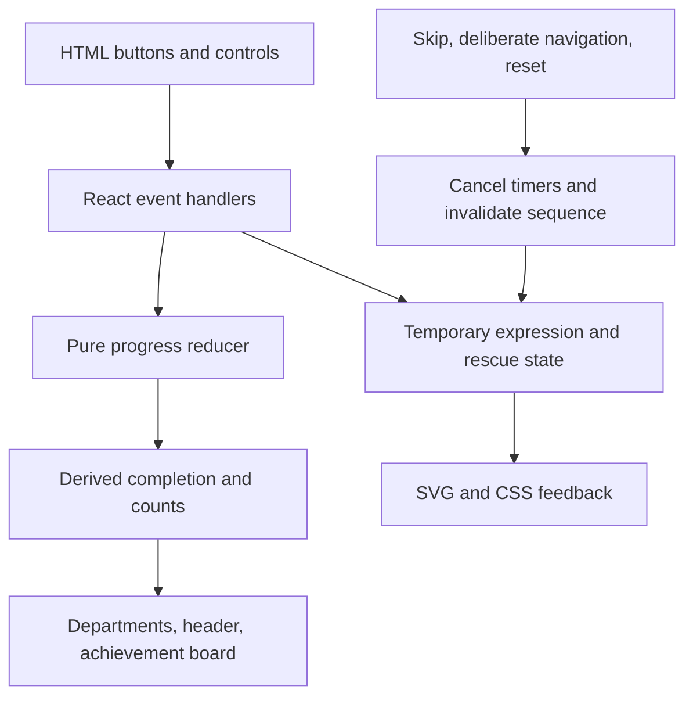

# Gloob's Cosmic Organization Headquarters — Technical Spec

## How This Works, In Plain Language

Gloob's headquarters is one browser page built with React and TypeScript. Vite prepares its code, original illustrations, styles, and fonts as static files. Vercel publishes those files from the GitHub repository. The visitor's browser does all the interactive work; there is no backend, account, API, database, or saved progress between page loads.

One authoritative progress record tracks placed stars, solved moon cases, and the orbital laboratory. A reducer is the function that checks each meaningful action against the current record before changing it. The achievement board and header read the same derived results instead of maintaining separate counters.

The cartoon is separate from this record. Gloob can panic, wobble, and celebrate, but finishing an animation never earns progress. A correct visitor action earns progress immediately; its animation illustrates the result. Skipping or resetting cancels obsolete presentation work, so a late callback cannot restore an old rescue or award a star.

One layered SVG character supplies every Gloob appearance. Original SVG objects, custom CSS, and self-hosted Lilita One and Nunito create the handmade office. Native HTML controls supply keyboard and touch behavior around the illustrations. Reduced motion keeps the same actions and outcomes with static poses and readable feedback.

Authority: [`../context.md`](../context.md), [`scope.md`](scope.md) and [`prd.md`](prd.md), both approved in frontmatter. Their stale closing references to earlier planning stages do not override approval. This specification does not modify those files or change their product requirements. All files and commands below are planned, not implemented.

## The Core Journey Through the System

Implements `prd.md > The Core Journey`, `Opening Demonstration and Rescue`, `Achievements, Completion, and Resets`.

1. The page mounts with a fresh progress record and an undiscovered Snack Drawer. Static content supplies the six stars, three cases, three lab objects, story, and profile.
2. WATCH ME ORGANIZE starts a presentation sequence. Its identifier distinguishes it from earlier canceled runs. The real crown star is temporarily unavailable for sorting, not credited or deleted.
3. The cartoon reaches the stable awaiting-boop step. BOOP advances presentation and makes the crown star available; it does not dispatch a progress-awarding action.
4. Selecting the crown star then Cosmic Crown sends a placement action. The reducer verifies the star, matching chart, and absence of previous credit. The chart and derived count update; local feedback celebrates.
5. Moon and orbit controls send their own department actions. They use separate rules, with no universal game abstraction.
6. Achievement selectors derive Stardust and moon completion from their records and read the lab's earned flag. A transition to three completed departments records which successful action completed the set so congratulations appear there.
7. Confirmed resets replace only the named department's record, invalidate its relevant presentation, and recompute achievements. Page navigation preserves progress; full reload recreates all initial state.



Diagram fallback: visitor action → validated reducer → authoritative record → derived displays. Visitor action → temporary presentation → art. Animation completion has no path to progress updates.

## Stack

### Agreed Choices and Tradeoffs

| Choice | Why it serves this project | Accepted cost/boundary |
|---|---|---|
| React + TypeScript + Vite | Reusable character and department components; typed actions; static production build | Build tooling and explicit types instead of a single handwritten HTML file |
| Inline SVG + semantic HTML | Controllable original art, crisp resizing, accessible native controls | Deliberate art authoring and hit-target alignment; no canvas or 3D engine |
| CSS animation/transitions | Brief expressions, orbit motion, and effects without animation dependencies | Keep choreography modest; animation is not application truth |
| Custom CSS tokens | Preserve the handmade early-web identity | Author a small visual vocabulary rather than use a large UI kit |
| Built-in useReducer | Testable progress rules in one place | Explicit actions and guards instead of scattered setters; no external store |
| Vitest + Testing Library | Focused reducer and observable interaction verification | jsdom cannot validate real layout, SVG motion, or touchscreen quality |
| Vercel GitHub integration | Production and preview builds from existing repository | Requires account/repository authorization and service availability |
| Local WOFF2 fonts | Stable self-contained typography without visitor-time font CDN requests | Store font files, provenance, and OFL notices |

### Version Baseline and Runtime

Read-only npm metadata checked during planning on 18 October 2026; these are the observed stable versions, not installed packages:

| Package | Baseline | Placement / documentation |
|---|---|---|
| react, react-dom | 19.3.1 together | Runtime; [React](https://react.dev/), [useReducer](https://react.dev/reference/react/useReducer) |
| typescript | 7.0.2 | Development; [TypeScript](https://www.typescriptlang.org/docs/) |
| vite | 8.3.4 | Development; [Vite guide](https://vite.dev/guide/) |
| @vitejs/plugin-react | 6.1.2 | Development; [official plugin](https://github.com/vitejs/vite-plugin-react) |
| vitest | 5.0.5 | Development; [Vitest guide](https://vitest.dev/guide/) |
| @testing-library/react | 16.3.3 | Development; [React Testing Library](https://testing-library.com/docs/react-testing-library/intro/) |
| @testing-library/user-event | 14.6.8 | Development; [user-event](https://testing-library.com/docs/user-event/intro/) |
| @testing-library/jest-dom | 7.0.1 | Development; [jest-dom](https://github.com/testing-library/jest-dom) |
| jsdom | 30.1.3 | Development; [jsdom](https://github.com/jsdom/jsdom) |
| @testing-library/dom | Compatible 10.x | Required testing peer dependency; [DOM Testing Library](https://testing-library.com/docs/dom-testing-library/intro/) |
| @types/react, @types/react-dom, @types/node | Compatible 19.x, 19.x, 24.x | Development type declarations; resolve and lock patches at setup |

The selected development environment is Node **24.x, minimum 24.15.0**, with npm. Pin the exact available compatible Node patch in `.nvmrc` at setup, and restrict package engines to `>=24.15.0 <25`. Set Vercel's Node major to 24.x and verify its actual build runtime meets the same minimum. Local and hosted patches may differ, but both must satisfy the locked dependency requirements. Vite's lower minimum alone is insufficient: current jsdom metadata requires `^22.22.2 || ^24.15.0 || >=26.0.0`; Vitest accepts this Node 24 range and Vite 8. Testing Library's declared React 19 and DOM 10 peers align with this baseline.

Verify all engines, required versus optional peers, and TypeScript compatibility at setup; metadata compatibility is not a passing installation or build. Use the ordinary React plugin without React Compiler or optional experimental transforms. Do not install optional canvas, browser-test runners, coverage packages, or compiler integrations just because they appear in peer metadata. Commit exact resolved versions in `package-lock.json`; do not use floating latest versions in reproducibility instructions. If the verified baseline cannot run in the available environment, resolve the version mismatch before building rather than bypassing peer checks. No packages were installed during planning.

## Where It Runs and How Someone Tries It

Implements `prd.md > What We're Building`, `States and Boundaries`.

Modern desktop and mobile browsers load a static public website. No API keys or environment secrets are needed. Use native hash links for sections, not client-side pathname routing.

Planned scripts:

| Command | Contract |
|---|---|
| `npm ci` | Reproduce the committed dependency lock after initial setup |
| `npm run dev` | Vite development server, localhost:5173; configure strict port for predictable instructions |
| `npm run dev -- --host 0.0.0.0` | Optional same-network real-device check using the machine's LAN address and port 5173 |
| `npm run test` | `vitest` watch mode |
| `npm run test:run` | `vitest run`, one-time suite |
| `npm run build` | `tsc -b` followed by `vite build`; TypeScript errors fail the build |
| `npm run preview` | Preview built `dist/` locally on localhost:4173, strict port |

Use LAN serving only on the developer's trusted network. Vite preview is a local check, not the public host. A visitor opens the assigned Vercel production URL once available; no URL is assumed now. A public deployment and GitHub repository are required by this event; a pitch video is not a mandatory deliverable in the supplied context.

### Vercel Deployment

Approved platform configuration, to be performed during implementation:

- Import **ThunderKhan/gloob** through Vercel's native GitHub integration; root directory is repository root.
- Framework preset: Vite. Install from npm lockfile (`npm ci`), build: `npm run build`, output: `dist`.
- Vite base: **`/`**, never `/gloob/`.
- Production branch: **main**. Development branch pushes produce previews; main pushes produce production deployments.
- No server functions, backend adapters, external API configuration, GitHub Pages workflow, or separate GitHub Actions deploy pipeline.
- Hash section links need no SPA pathname rewrite. No `vercel.json` is necessary unless a concrete verified hosting requirement arises.
- Record the assigned URL and Node setting in README during build. Confirm production is publicly accessible without Vercel login using a signed-out browser; preview access policies do not establish production accessibility.
- Deploy the responsive shell, primary Gloob, and working essential navigation early, before implementing the full rescue and department activities. Check live desktop/mobile behavior, fonts, asset paths, refresh, and hash navigation immediately; verify gameplay on subsequent deployments.
- Run tests and the production build before a release push. Native deployment runs the build; do not claim it automatically runs Vitest when the configured command is only `npm run build`.

References: [Vite on Vercel](https://vercel.com/docs/frameworks/frontend/vite), [Vercel Git integration](https://vercel.com/docs/git), [Node runtime settings](https://vercel.com/docs/functions/runtimes/node-js/node-js-versions). Account authorization, runtime availability, plan limits, and any cost remain deployment-time checks; no paid features are required by this design.

## Look and Feel

Implements `prd.md > Look and Feel`, `Screens and Layout`; preserves `scope.md > Inspiration & Identity`.

### CSS Tokens and Layout

Use shared semantic CSS variables for cosmic background, panel paper, ink, lilac glow, coral accent, yellow attention, muted text, focus, border, spacing, radius, and motion durations. Starting palette proposals: midnight `#21152F`, paper `#FFF5DF`, lilac `#C8A7EF`, coral `#F3A29C`, yellow `#FFDA69`; these are implementation seeds, not pre-certified accessible color pairs. Validate text at 4.5:1 for ordinary text, 3:1 for large text and important control boundaries. Dark ink on light panels is the default reading surface.

Mobile-first single-column sections; introduce the hero's Gloob/workbench columns only when both remain usable (initial breakpoint around 56rem, adjust by actual fit). Keep body copy around 1rem or larger, comfortable line height, fluid headings, minimum 44px practical targets, and wrapping controls. Desktop chart layouts may use three columns; narrow layouts stack them with full-chart buttons. Avoid fixed page-height scenes. Decoration may rotate; labels and hit targets remain orderly.

RetroWindow, stickers, stamps, dotted chart guides, crooked paper, and original illustrations supply the identity. They are custom components, not dashboard cards with a cosmic background. Department accents vary within shared tokens. Continuous decorative movement is sparse and disabled for reduced motion.

### Typography and Font Files

Approved: **Lilita One** for display headings/signs/major announcements; **Nunito** for instructions, speech, navigation, case files, and controls; system monospace for short counters and fictional machine labels.

- Locally host WOFF2; no visitor-time Google Fonts or CDN requests.
- Lilita One: normal 400. Nunito: normal 400, 600, 700; no unused italics or extra families. Prefer verified upstream-distributed Latin WOFF2 files; use three static Nunito weights for a straightforward asset contract.
- `@font-face` declarations use `font-display: swap`, correct weight/style, and local asset URLs. Display fallback: rounded system sans; body fallback: system-ui/sans-serif; machine labels: ui-monospace, Consolas, monospace.
- Source WOFF2 from a verifiable distribution such as [Fontsource Lilita One](https://fontsource.org/fonts/lilita-one) and [Fontsource Nunito](https://fontsource.org/fonts/nunito), retaining notices and recording the exact source/version. These are acquisition references, not runtime services or required npm dependencies.
- Upstream OFL notices were verified: [Lilita One, Juan Montoreano](https://github.com/google/fonts/blob/main/ofl/lilitaone/OFL.txt) and [Nunito Project Authors](https://github.com/google/fonts/blob/main/ofl/nunito/OFL.txt). Both are OFL 1.1. Retain their copyright and license text separately from original artwork licensing.
- WOFF2 binary selection and glyph coverage remain build-time verification: check actual punctuation and captions. Draw main constellation symbols in SVG; don't rely on emoji glyphs for core illustrations. Avoid custom font conversion/subsetting unless necessary; preserve reserved-name obligations if modifying font software.

### Original Artwork Preparation and Licensing

First build and review the primary Gloob at large, mobile, and small sizes. His irregular silhouette, cream eyes, shading, hands, belt, ring, and head-star must read without motion. Refine weak artwork before adding secondary assets. Reuse named SVG parts for reactions and story scenes; use a compact original set for stars, moons, planets, orbit objects, stickers, and office props.

Store artwork compositions under `src/art/`, including SVG geometry expressed in TSX. A wrapper in `components/gloob/` handles behavior; artwork files own shapes and expression poses. Use per-instance unique gradient/clip identifiers so multiple Gloobs cannot accidentally reference one another's SVG definitions. Avoid expensive filters, extremely elaborate paths, and mixed styles.

User licensing decision: source code MIT, original character illustrations reserved unless separately licensed. During build, retain MIT text for code and add a clear repository licensing overview and artwork notice identifying `src/art/` and any exported original images as exceptions. Do not assume the root MIT license automatically excludes artwork, especially geometry embedded in TSX. Font notices retain OFL terms. Record original agent-assisted artwork credit and third-party provenance in credits. Copyright ownership/enforceability is not established by this technical document; use the user's rights notice without inventing an owner name.

## Components

Each heading is a build reference. Keep small supporting markup within its owning component unless reuse actually warrants extraction.

### App / Headquarters Coordinator

Implements `prd.md > The Core Journey`, `States and Boundaries`. Owns the mounted `useReducer` progress record, presentation cancellation entry point, and secret discovery lifetime. Renders sections continuously so anchors and same-page navigation preserve state. Pass explicit state/dispatch props to the few department components; no router, global store package, or broad context system needed. Coordinate deliberate navigation and cross-department actions before processing them.

### HeaderNav and DepartmentDirectory

Implements `prd.md > Screens and Layout`. Native links to `#home`, `#projects`, `#story`, `#about`, `#achievements`; directory links to `#stardust`, `#moons`, `#orbits`. Header count comes from selectors. Clicking a section link cancels unfinished intro presentation before following the anchor; normal scroll never cancels it. Handle explicit hash navigation consistently, including browser history changes. Focus the destination heading for deliberate in-page navigation, without focus movement during ordinary scrolling.

### GloobCharacter

Implements `prd.md > Gloob's Presence and Personality`, `Opening Demonstration and Rescue`, `Gloob's Secret Snack Drawer`. Wraps the reusable GloobArt composition. Props describe expression, size, reduced motion, and whether this instance has active tummy/head-star controls. Only the hero's designated head-star opens the drawer; other decorative instances are noninteractive unless explicitly given an approved role.

Expressions: happy, proud, confused, panicked, embarrassed, excited, sleepy. Eye tracking changes bounded pupil offsets on fine-pointer devices, using a locally scoped pointer listener and at most one requestAnimationFrame update at a time. Do not rerender the whole application per pointer movement. Disable tracking and unnecessary wobble for reduced motion; return pupils to neutral on pointer exit. Listeners/frames clean up on unmount.

Use separately positioned HTML buttons for the visible tummy target and head-star, plus the visible BOOP GLOOB rescue button. They invoke the same rescue action where appropriate, are not nested controls, and have reliable targets tied to the SVG's aspect ratio. Decorative SVG layers use pointer-events none and are hidden from assistive technology when surrounding text already describes them. Meaningful portraits have appropriate accessible descriptions.

### StardustDepartment and useRescuePresentation

Implements `prd.md > Opening Demonstration and Rescue`, `Stardust Sorting Co.`. Owns loose-star selection, charts, counts, reset trigger, and local speech. `useRescuePresentation` owns the introductory phase, practice mode, timers, and generation guard. Progress stays in the app reducer. The recovered crown is a designated stable star ID, not a newly created star. Whole-chart HTML buttons implement placement; no drag dependency.

### MoonDepartment

Implements `prd.md > Lost Moon & Found`. Shows three case buttons, active case, optional evidence reveal, and labeled planet destination buttons. Local state stores active case, revealed clues, and feedback; reducer stores solved assignments. Beginning an interaction dismisses unfinished intro presentation through the shared coordinator. A solved file remains inspectable; its destination actions cannot award credit. Reset clears local case/evidence state and authoritative moon progress only.

### OrbitDepartment and useOrbitMotion

Implements `prd.md > Orbit Organizer 3000`. Provides fixed accessible object selectors, three large labeled ring controls, RETURN TO INVENTORY, global speed/direction, START/PAUSE/RESUME, and reset. Visual moving objects are decorative projections of the same assignment record; a stationary selector remains available so users never have to catch a moving comet.

`useOrbitMotion` controls only angles and SVG transforms. For continuous speed/direction changes without jumps, a tiny requestAnimationFrame loop accumulates angle from elapsed time and the selected signed speed. This is a three-object visual helper, not physics or a game engine. Initial Normal periods may be 12/18/24 seconds on inner/middle/outer rings, Slow at half speed and Fast at double speed. Clamp excessive time deltas on tab return. Pause cancels advancement while retaining angles; resume continues them. In reduced motion, stop the loop and show stable positions with operating status. Cleanup always cancels pending frames. Neither frames nor orbit positions affect completion.

Keep current angles, timestamps, frame IDs, and current motion settings in local refs. Each frame writes only the dedicated SVG transform attributes through element refs; it must not call React state setters or dispatch progress actions. React owns structure and control/status updates, while the helper exclusively owns these per-frame transform values. Maintain at most one active loop. Cleanup on unmount, pause, reset, and reduced-motion activation cancels the pending frame and prevents an obsolete callback from scheduling another. This must also survive development Strict Mode setup/cleanup.

Speed/direction changes retain angles and affect subsequent advancement without changing paused/running status. Pause retains angles; resume starts a fresh timestamp baseline so paused time is not added as a jump. Re-enabling motion resumes only if the authoritative machine mode is running. Reduced motion stops continuous movement, not valid activation, status transitions, or achievement eligibility. The helper never changes assignments, mode, earned completion, or any other authoritative record.

### OriginStory

Implements `prd.md > Origin Story and Employee Profile`. Three semantic illustrated scenes using shared art and captions. An IntersectionObserver can activate a brief entrance illustration change; content is visible and readable before observation and with reduced motion. No scroll hijacking, pinned cinematic, or progress events.

### CharacterProfile and Credits

Implements `prd.md > Origin Story and Employee Profile`, `What We're Building`. Explicitly labels all five canon fields, with short humorous credentials. Credits distinguish source code, original agent-assisted art, OFL fonts, and dependencies. No hidden essential identity text.

### SnackDrawer

Implements `prd.md > Gloob's Secret Snack Drawer`. App-lifetime discovery counter/discovered flag; local open/released-object state. Three native head-star clicks first reveal it; one click reopens after discovery. Native button semantics cover Enter/Space without separate key handlers that would double-count activations. Each open restores contents; release only changes drawer presentation. Use a styled native dialog with title, visible Close, Escape, focus management, and return to the invoking head-star. Ensure the real-browser dialog implementation works; jsdom shims cannot establish that.

### AchievementBoard and CompletionFeedback

Implements `prd.md > Achievements, Completion, and Resets`. Read the same selector output as HeaderNav. Three slots only. CompletionFeedback renders beside the department whose action changed the total from below three to three. Its celebratory animation is cosmetic; the message remains readable. Reset below three clears the all-complete location/message; re-completion can set it again. No independently maintained sticker array or total.

### RetroWindow, ActionButton, StatusMessage, ConfirmReset

Implements `prd.md > Look and Feel`, `Accessibility and Responsive Behavior`. Small shared primitives: titled section framing, native button styling, persistent status with restrained polite announcements, and a native confirmation dialog. ConfirmReset names the department, offers explicit confirm/cancel, focuses the safe initial action, and restores focus to the opener. No generic game framework or widget library. Use dialog cancellation as cancellation only, not a reset.

## Data Model

### Static Content

Typed immutable records in `src/content/`: six star IDs with matching chart IDs (crown-1 is the rescue star), three charts, three moon/planet mappings and clues, three orbit object IDs and ring IDs, named dialogue, story/profile content, and credit records. This is authored fictional portfolio content, not fetched or procedurally generated data. Use stable IDs for logic and names for display.

### Authoritative Progress

Implements `prd.md > States and Boundaries`, each department's behavior, and `Achievements, Completion, and Resets`.

| Record | Contents | Mutation and lifetime |
|---|---|---|
| stardust | Unique placed star IDs in placement order | Valid placement appends once; Stardust reset clears |
| moons | Solved case IDs (correct destination follows from static mapping) | Correct active-case action adds once; moon reset clears |
| orbit | Object-to-ring assignments; speed; direction; mode editing/running/paused; earned flag | Valid lab actions; lab reset restores defaults and earned=false |
| allCompleteAt | Department ID or null | Pure transition metadata set only on a successful progress action that changes total to three; cleared when total falls below three |

Keep the reducer pure: no timers, DOM access, random generation, or animation callbacks. TypeScript discriminated action types and exhaustive handling make department rules explicit. Reject unknown IDs and invalid payload combinations at the boundary; do not trust UI disabling as the sole safeguard.

Derived selectors: star count = number of unique placed IDs; filled chart sockets = placed stars belonging to that chart; star complete = six; moon count = solved cases; moon complete = three; orbit complete = earned; overall count = sum of the three completion booleans. The board and header both consume these selectors.

The orbital earned flag is necessary rather than redundant: once a valid system was activated, temporarily removing an object does not revoke its achievement. An incomplete current arrangement and an earned lab sticker can intentionally coexist.

### Progress Actions and Guards

| Action | Required validation | Result |
|---|---|---|
| PLACE_STAR(starId, chartId) | Known IDs, correct category, not previously placed, chart has capacity | Append once; duplicates/wrong matches leave progress untouched |
| RETURN_MOON(caseId, planetId) | Known unsolved case, correct planet | Add solved case once; no evidence-reveal requirement |
| ASSIGN_ORBIT(objectId, ringId) | Known object/ring; ring free or already owned by that same object | Assign/move to free ring; same assignment is harmless |
| RETURN_ORBIT_OBJECT(objectId) | Object is assigned | Remove assignment, set editing, retain earned and movement settings |
| START_ORBITS | All three objects on distinct rings, mode editing | Set running and earned=true; no duplicate award |
| PAUSE_ORBITS / RESUME_ORBITS | Running / paused respectively; full arrangement for resume | Change mode only |
| SET_SPEED / SET_DIRECTION | Allowed enum value | Update setting, preserve mode/earned |
| RESET_DEPARTMENT(id) | Known department; dispatched only after explicit confirmation | Replace that department with its initial record, preserve others |

No rescue/animation event can award reducer credit. Boop, replay, and dismissal have no progress mutation. UI event handlers supply the active case/star selection; invalid actions remain no-ops even if sent twice. A reset button's click only opens confirmation; cancellation dispatches no reset.

After any progress action, compute before/after completion selectors. Set allCompleteAt only when crossing to three; clear below three. Resetting an incomplete department cannot lower the count. Lab experimentation while earned stays at the same count and does not replay global congratulations.

### Temporary State Ownership

| State | Owner | Reset/cancellation rules |
|---|---|---|
| Rescue phase, practice flag, sequence ID | useRescuePresentation in mounted hero | Skip/navigation/other activity cancels; Stardust reset cancels; unmount cleans up |
| Star selection and local feedback | StardustDepartment | Clear selection after valid placement/reset; retain it on wrong match |
| Active case and revealed evidence | MoonDepartment | Preserve through same-page navigation; clear on moon reset |
| Selected orbital object and visual angles | OrbitDepartment / motion helper | Preserve while experimenting; reset angles/selection on lab reset |
| Expressions, speech, sparkle runs | Owning department/Gloob wrapper | Never authoritative; cleanup and invalidate on relevant reset/replacement |
| Secret activations/discovered | App lifetime | Survives department resets/navigation; full reload clears |
| Drawer open and released objects | SnackDrawer | Reinitialize contents every open; closing restores focus |
| Reset confirmation target | App/dialog owner | Confirm one department or cancel with no progress change |

All records are in memory. No localStorage, sessionStorage, cookies, URL-encoded progress, or persistence middleware. Hash links identify sections only. Full reload recreates initial records and secret discovery.

### Rescue Phases and Interruption Safety

Implements `prd.md > Opening Demonstration and Rescue`.

Stable progression: intro-ready → demonstrating → awaiting-boop → releasing → awaiting-placement → ordinary sorting. A practiced already-placed star follows demonstrating → awaiting-boop → releasing → ordinary sorting without a real placement phase. Dismissal from any unfinished phase returns to ordinary sorting; repeat is always explicit.

- Each start/replay receives a monotonically increasing sequence ID. Every scheduled presentation callback captures it and its expected phase.
- Cancel clears all scheduled timers/listeners and invalidates the ID. Callback checks both the current ID and phase before updating presentation. Clear timers on unmount; development Strict Mode must not leak extra timers.
- Animation completion events are optional cosmetic cues. Use one cancelable presentation schedule with an immediate reduced-motion path and a bounded fallback to the next stable step, so a missing CSS animation event cannot trap the rescue.
- Reduced motion immediately reaches awaiting-boop after explicit start; boop immediately reaches placement or ends practice. The visitor still performs meaningful actions.
- Duplicate boops while releasing or after release do nothing. Both tummy and rescue button call the same guarded handler.
- While the real star is swallowed, it is visually withheld by the presentation phase; its authoritative placement record is unchanged. Dismissal simply reveals it again if unplaced. Practice uses a temporary visual star outside the six-star collection.
- Ordinary sorting after skip has all unplaced stars available. A later real placement increments the current count; never overwrite it with 1/6.
- Navigation coordination cancels presentation before following section anchors. Starting a moon/lab action cancels unfinished rescue before that action. Scrolling alone does neither. Reset handlers invalidate relevant callbacks before dispatching reset and clearing local selection.
- Any other scheduled department expression uses local cleanup on replacement/reset; no global animation orchestration framework is needed.

## Accessibility and Responsive Implementation

Implements `prd.md > Accessibility and Responsive Behavior`, and all department criteria.

- Native buttons for objects/destinations, native radio groups or select controls for speed/direction, semantic headings/landmarks, visible labels, visible focus, and a skip-to-main link. Avoid custom keyboard grids unless a real need emerges.
- Selected items use both visual treatment and `aria-pressed` or appropriate native semantics. Disabled START is paired with a persistent explanation of remaining objects. Fixed object selectors remain usable while decorative orbital visuals move.
- Announce meaningful counts/results through restrained polite status regions. Do not announce every frame, pointer movement, or idle quip. Keep primary instructions visible rather than timing them away.
- After a placement removes the focused loose object, retain a usable focus location such as the activated destination; do not drop focus to the document body. After modal close restore the invoking control. Test actual browser behavior.
- Use `prefers-reduced-motion` in CSS plus a small reactive matchMedia hook for JS-controlled eye/orbit/rescue behavior. Changing the preference mid-sequence cancels decorative movement and advances to a valid stable interaction step without changing progress.
- Meaningful planet features and labels appear in HTML descriptions as well as artwork. Wrong matches never rely only on a wiggle; completed charts retain stamps and counts.
- Test 320–390px phone widths, tablet portrait/landscape, desktop, enlarged text/200% zoom, and a real phone. Exact breakpoint is based on fit, not a fixed desktop scene scaled down.
- Native dialog behavior is allowed for Snack Drawer/reset confirmation; the introductory rescue never uses a modal overlay. No essential content requires discovering the secret.

## File Structure

Planned files; generated dependency contents omitted. Preserve existing documentation. Smaller helper markup stays inside its owner rather than multiplying files.

```text
gloob/
├── context.md                         # Existing canonical context, preserved
├── docs/
│   ├── scope.md                       # Approved, preserved
│   ├── prd.md                         # Approved, preserved
│   ├── spec.md                        # This blueprint, diagrams included
│   └── verification.md                # Build-stage manual evidence and release checks
├── LICENSE                            # Existing code MIT text; inspect before any amendment
├── LICENSING.md                       # Code/art/font boundaries, created during build
├── README.md                          # Startup, assigned live URL, credits, release instructions
├── .gitignore                         # Dependencies, dist, local artifacts
├── .nvmrc                             # Exact verified Node 24 patch
├── package.json                       # Scripts, engines, runtime/dev dependencies
├── package-lock.json                  # Reproducible dependency resolution
├── index.html                         # Vite entry and basic metadata
├── tsconfig.json                      # Project references
├── tsconfig.app.json                  # Strict application/test typing
├── tsconfig.node.json                 # Build configuration typing
├── vite.config.ts                     # React plugin, base /, ports, test config
├── public/
│   ├── favicon.svg                    # Original small Gloob mark; covered by artwork notice
│   └── fonts/
│       ├── lilita-one-latin-400.woff2
│       ├── nunito-latin-400.woff2
│       ├── nunito-latin-600.woff2
│       ├── nunito-latin-700.woff2
│       ├── lilita-one-OFL.txt
│       └── nunito-OFL.txt
└── src/
    ├── main.tsx                       # React mounting and stylesheet imports
    ├── App.tsx                        # Progress owner and navigation coordination
    ├── state/
    │   ├── types.ts                   # IDs, state records, action union
    │   ├── initialState.ts            # Fresh independent initial records
    │   ├── progressReducer.ts         # Pure validation and transitions
    │   ├── selectors.ts               # Counts, stickers, chart fills
    │   └── progressReducer.test.ts    # Reducer and derived-result invariants
    ├── content/
    │   ├── departments.ts             # Stars, charts, cases, planets, lab objects
    │   ├── copy.ts                    # Dialogue, story, profile
    │   └── credits.ts                 # Provenance and license references
    ├── art/
    │   ├── ARTWORK-NOTICE.md           # Reserved original illustration boundary
    │   ├── GloobArt.tsx               # Layered original SVG and named facial poses
    │   ├── CelestialArt.tsx           # Original stars/moons/planets/lab objects
    │   └── OfficeArt.tsx              # Shared props, stickers, stamps, scene compositions
    ├── components/
    │   ├── HeaderNav.tsx
    │   ├── DepartmentDirectory.tsx
    │   ├── gloob/GloobCharacter.tsx    # Art wrapper, eye tracking, distinct hit targets
    │   ├── ui/RetroWindow.tsx
    │   ├── ui/ActionButton.tsx
    │   ├── ui/StatusMessage.tsx
    │   └── ui/ConfirmReset.tsx
    ├── features/
    │   ├── stardust/StardustDepartment.tsx
    │   ├── stardust/useRescuePresentation.ts
    │   ├── stardust/rescue.test.tsx    # Skip, boop, replay, stale presentation protection
    │   ├── moons/MoonDepartment.tsx
    │   ├── orbits/OrbitDepartment.tsx
    │   ├── orbits/useOrbitMotion.ts    # Presentation-only angles/frames
    │   ├── story/OriginStory.tsx
    │   ├── profile/CharacterProfile.tsx
    │   ├── profile/Credits.tsx
    │   ├── snack/SnackDrawer.tsx
    │   ├── achievements/AchievementBoard.tsx
    │   └── achievements/CompletionFeedback.tsx
    ├── hooks/useReducedMotion.ts
    ├── styles/
    │   ├── tokens.css                 # Palette, spacing, typography and motion roles
    │   ├── fonts.css                  # Self-hosted font declarations and fallbacks
    │   ├── global.css                 # Base, focus, layout, responsive rules
    │   ├── components.css             # Retro windows, character, buttons, dialogs
    │   └── departments.css            # Workspaces and controlled animation rules
    └── test/
        ├── setup.ts                   # jest-dom, cleanup, minimal browser API shims
        └── critical-controls.test.tsx # Small keyboard/shared-reset integration checks
```

No Pages workflow, deploy workflow, service folder, router layer, asset generation service, or engine directory is planned.

## External Services and Dependencies

The core browser experience makes no application API calls: no endpoints, payload contracts, API keys, rate limits, or paid runtime APIs. Files come from the deployed origin. Vercel/GitHub are build/distribution services, not gameplay dependencies. npm and font sources are setup-time acquisition sources. Fonts and artwork are served locally thereafter.

Browser-platform references: [SVG](https://developer.mozilla.org/en-US/docs/Web/SVG), [requestAnimationFrame](https://developer.mozilla.org/en-US/docs/Web/API/Window/requestAnimationFrame), [dialog](https://developer.mozilla.org/en-US/docs/Web/HTML/Element/dialog), [reduced motion](https://developer.mozilla.org/en-US/docs/Web/CSS/@media/prefers-reduced-motion), [font-face](https://developer.mozilla.org/en-US/docs/Web/CSS/@font-face). No animation, game, external state, or UI-component package is added.

## Verification Plan

Implements the acceptance criteria under every `prd.md > Features and Behavior` heading.

### Reducer Tests — First Priority

Use Vitest in a Node environment for pure reducer/selector tests. Small table-driven cases cover:

- Valid star placement, wrong category, duplicate ID, and chart capacity; wrong/duplicate actions leave counts unchanged.
- Correct/incorrect/duplicate moon returns, no evidence prerequisite, and unrelated progress preserved.
- Orbit start rejected before all three distinct rings are filled; first valid start earns; pause/resume/reassignment/return/settings preserve earned; occupied assignment rejected; reset restores Normal/Clockwise/editing/unearned.
- Each department reset independently preserves the other records; resetting an incomplete department does not decrement derived totals.
- Every order of three department completions reaches 3/3; reset reaches 2/3; re-completion restores congratulations at the relevant department.
- Rescue has no progress-awarding event: replay/boop cannot mutate this reducer. Verify actual replay isolation in interaction tests rather than inventing a fake reducer replay action to test.

### Essential Interaction Tests

Use jsdom only for relevant component tests, React Testing Library role/name queries, user-event click/keyboard, and jest-dom assertions. Setup imports the Vitest-compatible jest-dom entry, cleans rendered trees, and supplies only needed matchMedia/dialog shims. Shims are not proof of browser dialog correctness.

Cover start/skip, one-boop release and actual crown placement, deliberate departure versus ordinary scroll, replay after credit, and explicit reset cancellation/confirmation. With controlled timers, start a sequence, interrupt/reset, advance past old delays, and assert the current controls/dialogue/progress remain correct. Configure user-event's timer advancement when fake timers are used; restore real timers per test. Include a small keyboard path and shared count/reset assertion. No extensive snapshots, coverage thresholds, Playwright, Cypress, browser-runner infrastructure, or tests mirroring every decorative element.

### Manual Browser Evidence

Record device/browser, viewport, action, observed result, and any issue in `docs/verification.md` during build:

| Area | Required evidence |
|---|---|
| Character and art | Gloob readable large/mobile/small; expressions, head-star/tummy distinct; no duplicate SVG IDs or clipped artwork |
| Opening and stars | Rescue, skip at multiple steps, navigation, replay after credit, rapid activation, reset during animation; all six placements and chart stamps |
| Moon department | Both clue paths, optional second clue, all three matches, wrong attempts, solved inspection, reset |
| Orbit lab | All placements, occupied ring, start/pause/resume, speed/direction, return/rearrange, retained sticker, confirmed reset |
| Story/profile/secret | Three scenes, five fields, first three clicks, reopen once, release/reopen restores objects, close/focus, reload undiscovered |
| Achievements | Third department in different orders, local congratulations, 3/3 → reset → 2/3 → recomplete; header/board agreement |
| Accessibility | Entire core keyboard path, visible focus, dialog exit/focus return, non-color clues, reduced motion including preference change mid-rescue, enlarged text |
| Responsive | Desktop, tablet, small phone, real touchscreen; no clipped controls, moving-target dependence, or navigation obstruction |
| Production | Signed-out public URL, root asset URLs, local fonts, console/network errors, refresh/hash links, same-visit preservation and fresh reload |

jsdom does not establish layout, actual touch behavior, SVG rendering, animation smoothness, or browser accessibility. Emulation supports checks but does not replace a real phone. Log any unavailable device coverage honestly rather than claim it was verified.

For orbital motion, also verify that React components do not commit on every animation frame, pause/resume preserves positions, changing settings does not teleport objects, and unmount/reduced-motion activation leaves no active loop. Use a brief real-browser performance/React profiling inspection and focused cleanup checks, not a new testing platform.

### Implementation Checkpoints

Use this planning order. The later `5-build` stage must break each checkpoint into small independently verifiable slices, not one enormous change per checkpoint. Accessibility and responsive semantics are built into each slice; the final checkpoint verifies the complete experience.

1. Establish the project structure and working development environment; verify Node/package compatibility, scripts, and committed `package-lock.json`.
2. Create Gloob's primary layered SVG illustration.
3. Review his silhouette, seven facial expressions, and appearance at desktop, mobile, and small sizes; improve the primary art before multiplying secondary assets.
4. Build the headquarters shell and essential navigation.
5. Establish a functional early Vercel deployment of that shell and verify the live site on desktop and mobile.
6. Implement authoritative progress rules, selectors, and relevant tests.
7. Build the opening rescue and Stardust Sorting Co., including interruption, replay, and progress-safety tests.
8. Complete Lost Moon & Found and Orbit Organizer 3000.
9. Add the story, character sheet, achievement displays/final acknowledgment, and Secret Snack Drawer, wiring them to the existing rules.
10. Complete accessibility verification, visual polish, production testing, and submission preparation, protecting at least three hours for finishing work.

### Release Checks and Time Protection

Run `npm run test:run` and `npm run build`, then inspect `npm run preview` and the deployed Vercel build. Resolve console errors and broken assets. Confirm the final deployed commit matches the intended submission. Check live URL, public repository history within the event window, written build story, character sheet, and credits before **19 October 2026, 17:17 IST**.

Maintain the provisional 12–16-hour total with at least three hours for final cross-device checks, fixes, deployment, and submission. This spec does not turn the planning budget into a guaranteed estimate. Protect early Gloob art review and early deployment; keep tests concentrated on the listed invariants. Use the approved reduction order for optional extras and decorative complexity. Do not silently remove a required interaction or a documented control to fit the clock.

## Important Failure Modes

- **Stale animation finishes after skip/reset:** cancel and generation-check presentation; successful progress never comes from callbacks. Visitor sees stable normal sorting, not a resurrected rescue. Test old timers after cancellation.
- **Three displays disagree about achievement progress:** derive from one record; only the necessary orbital earned flag is stored. Test reset/re-complete and experimentation at 3/3.
- **SVG art or targets fail at small sizes:** review the main character early; fixed aspect-ratio wrapper, bounded HTML targets, unique SVG IDs, and stationary object controls. Simplify surrounding decoration before shrinking controls.
- **Orbit CSS restarts cause motion jumps:** keep continuous angles in the tiny presentation-only frame helper; speed and direction affect angle advancement, pause retains position, reduced motion renders static. Real-browser verification is required.
- **Missing font or incomplete glyph coverage:** readable system fallback with swap; verify chosen WOFF2 files and punctuation, retain notices. Never block controls waiting for fonts.
- **Dialog/browser API mismatch in jsdom:** narrowly scoped test shims and separate real-browser keyboard/touch checks. Do not treat simulated pass results as proof of native dialog UX.
- **Hosting/runtime or public-access mismatch:** deploy early, match Node major, inspect build log and assigned origin, verify signed-out access. No `/gloob/` base or unneeded pathname rewrite.
- **Artwork preparation expands beyond budget:** reusable layered character and small asset vocabulary; refine primary face/silhouette first, then reuse. No external image-generation dependency or dozens of custom detailed scenes.

## What Was Simplified and Why

- Static browser-only records instead of services — all approved experience is local to one visit.
- Built-in reducer and explicit props instead of a store framework — three departments and one shared board have a small, understandable data flow.
- Named SVG poses and CSS effects instead of an animation engine — expressiveness without complex runtime infrastructure.
- One tiny orbital angle helper instead of physics — supports immediate direction/speed and pause without simulating gravity.
- Stationary accessible controls instead of drag/moving-object targeting — same actions work on keyboard and touch.
- Original shared illustration parts instead of separately generated character images — consistent identity and clear production provenance.
- Focused reducer/interaction tests plus actual browser checks instead of a large E2E platform — verification effort targets the consequential risks.
- Root hash navigation instead of a router or desktop simulation — simple discovery and static deployment.

## Decisions and Open Issues

### Approved in the Technical Interview

React/TypeScript/Vite; SVG and semantic HTML; CSS motion/custom tokens; useReducer authoritative progress and separate presentation; no external game/state/UI engine; original agent-authored layered SVG art; seven reusable expressions; code MIT and original illustration reservation; Vitest/Testing Library/user-event/jsdom/jest-dom as dev dependencies; Vercel native integration with ThunderKhan/gloob and main production; Lilita One/Nunito self-hosted with OFL notices and system monospace. Reasons and tradeoffs appear above.

### Approved Implementation Details

Typed action records and selectors; explicit props from App; cancellation generation IDs; native dialogs; stationary lab controls; small presentation-only orbital frame helper; starting CSS palette and breakpoints; static font-weight files; Node 24 baseline and observed version set; annotated file boundaries. These derived blueprint choices are covered by the final architecture approval, with the orbital safeguards and implementation checkpoint order made explicit. Dependency installation compatibility remains unverified until implementation.

### Useful Uncertainty Resolved

The user singled out asynchronous animation and progress reliability. The agreed answer is to award progress only through validated visitor actions, keep animation state separate, derive achievements, and invalidate callbacks after interruption. The orbital earned flag clarifies the apparent exception: temporary arrangement edits do not undo an already-earned accomplishment. Reducer invariants plus stale-callback interaction tests are the evidence that this boundary holds.

### Remaining Verification, Not New Product Decisions

- At setup, verify/install a compatible locked package set, type declarations/required peers, Node patch, and Vercel runtime. No installation/build has yet demonstrated compatibility.
- Obtain and verify actual WOFF2 binaries, glyph coverage, exact provenance, and licenses. Notices have been checked; assets have not been downloaded.
- The assigned Vercel URL, GitHub authorization, public-access setting, and real-device availability remain operational checks during implementation.
- Exact final colors, motion durations, and dialogue wording can be refined within the PRD after browser review. No product-defining architectural question remains blocked.

### Community Reference

[Common Stale Closure Bugs in React](https://dev.to/cathylai/common-stale-closure-bugs-in-react-57l6), Cathy Lai (@cathylai), explains how timers/listeners retain obsolete state and why cleanup/current-state handling matters. It informs the cancellation review; the project's sequence guards and prohibition on animation-earned credit are our specific design, not a claim that the article implements Gloob's architecture.

### Final Consistency Audit

Every approved PRD behavior has a component and verification home above, including independent resets, safe rescue replay, lab completion during experimentation, secret reopening, and fresh reloads. The annotated file tree matches those responsibilities. Vercel is the only approved deployment platform; all documentation paths use `docs/`, and no Pages settings or deployment pipeline are prescribed. MIT application code is explicitly separated from reserved original illustration markup, including TSX geometry, and each self-hosted font has its own OFL notice. No new runtime dependency, backend, framework, or product feature was introduced by this audit.

This specification is **approved** following the final consistency audit and requested safeguards. Approval does not itself install packages, configure Vercel, generate artwork, or begin `5-build`.
